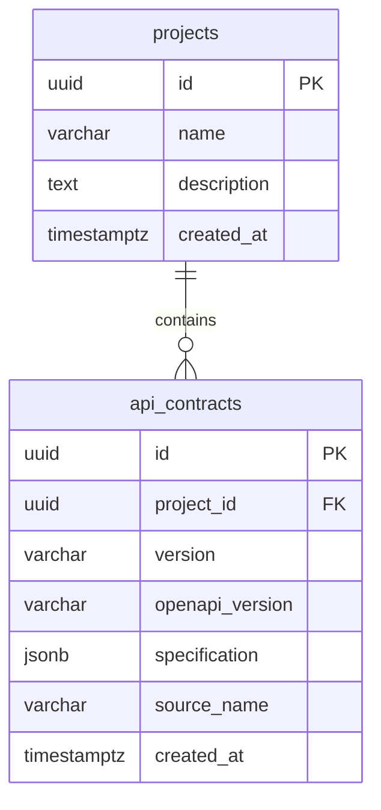

# API Contract Copilot

Analyze how OpenAPI contract changes affect consumer integrations, then produce evidence-backed impact reports and migration plans.

**Status:** database foundation and tested starter infrastructure. SQLAlchemy project/contract models, Alembic migrations, pgvector enablement, and database readiness are implemented. Upload APIs, comparison, RAG, agents, approvals, and MCP remain tracked implementation work.

[Project and task tracker](https://github.com/users/r-kovalenko/projects/2) · [CI runs](https://github.com/r-kovalenko/api-contract-copilot/actions)

## Repositories

| Repository | Responsibility |
| --- | --- |
| [api-contract-copilot](https://github.com/r-kovalenko/api-contract-copilot) | React UI, FastAPI modular monolith, application data, orchestration, RAG, approvals, and Copilot MCP |
| [api-provider-demo](https://github.com/r-kovalenko/api-provider-demo) | Synthetic versioned customer API, OpenAPI contracts, changelog, migration docs, and planned provider MCP |
| [api-consumer-demo](https://github.com/r-kovalenko/api-consumer-demo) | Example v1 integration, compatibility tests, and planned consumer MCP |

Keep the frontend and backend together so cross-layer changes can be tested and reviewed in one pull request. The two demo repositories provide independent codebases for MCP integration.

## Local development

Requires Python 3.12, Node.js 24, and Docker with Compose for containers.

```sh
cd backend
python -m venv .venv
# Windows: .venv\Scripts\Activate.ps1
# macOS/Linux: source .venv/bin/activate
python -m pip install -r requirements-dev.txt
python -m uvicorn app.main:app --reload
```

In another terminal:

```sh
cd frontend
npm ci
npm run dev
```

Backend liveness: http://localhost:8000/api/health. Database readiness: http://localhost:8000/api/ready. API docs: http://localhost:8000/docs. Vite prints the frontend development URL. The starter UI does not yet call application APIs.

For the container stack, copy `.env.example` to `.env`, set a unique local `POSTGRES_PASSWORD`, then:

```sh
docker compose up -d --build
# Explicit schema changes; application startup never runs migrations automatically:
docker compose exec backend python -m alembic upgrade head
docker compose exec backend python -m alembic current
```

Container UI: http://localhost:8080. Compose starts PostgreSQL with pgvector and passes database settings only to the backend. Readiness returns HTTP 503 until migrations are applied, and HTTP 200 afterward. Local database credentials are development-only. Changing `.env` credentials does not change credentials in an already initialized database volume.

## Database models

The implemented foundation is in [backend/app/db/models.py](backend/app/db/models.py), with its initial migration in [backend/alembic/versions/0001_projects_contracts.py](backend/alembic/versions/0001_projects_contracts.py).

| Model / table | Columns | Relationships and constraints |
| --- | --- | --- |
| `Project` / `projects` | UUID `id`, `name` (200 characters), nullable `description`, timezone-aware `created_at` | Nonblank name; one project has many contract versions |
| `ApiContract` / `api_contracts` | UUID `id`, UUID `project_id`, `version` (100 characters), `openapi_version` (20 characters), JSONB `specification`, nullable `source_name` (255 characters), timezone-aware `created_at` | Required project FK; unique `(project_id, version)`; nonblank version; OpenAPI version starts with `3.`; specification must be a JSON object |



UUIDs are generated by the Python model; creation timestamps are generated by PostgreSQL. The composite uniqueness constraint also indexes project/version lookup. Database foreign keys block deleting a project that still owns contracts. The repository lookup requires both project ID and contract ID. `session_scope(engine)` commits successful work and rolls back failures. These persistence controls do not implement authentication or full OpenAPI validation; those belong to the upload/API feature.

The initial migration enables the database-wide `vector` extension. The migration role needs permission to create it, or an administrator must provision it first. Embeddings are not stored yet. Downgrading to `base` deletes the two application tables and their data, but deliberately retains the potentially shared extension. Back up data before downgrading.

For a backend running outside Compose, export a server-only `DATABASE_URL` using the `postgresql+psycopg://` scheme, then run `python -m alembic upgrade head` from `backend/`. Percent-encode special characters in URL credentials. Compose safely constructs the URL from its separate `POSTGRES_*` values unless `DATABASE_URL` overrides them. Python does not automatically load `.env`. Never put the database URL in frontend variables or commit its populated value.

`/api/ready` requires connectivity, the current Alembic head, and the vector extension. Driver errors return a generic HTTP 503 without credential or connection details. Connections and queries have bounded timeouts; `/api/health` remains a process-only check.

Planned models from the [system design](docs/system-design.md) are intentionally deferred to their feature migrations: documents/chunks (RAG), contract changes and analysis runs (analysis), sessions/messages/workflow states/tool calls (orchestration), and migration plans/approval requests/migration tasks (planning and approval).

## Tests and CI

```sh
cd backend
python -m ruff check .
python -m ruff format --check .
python -m pytest --cov=app
cd ../frontend
npm ci
npm run typecheck
npm test
npm run build
```

Database tests use a **disposable, initially empty PostgreSQL database whose name ends in `_test`**, with pgvector available. Export its URL as `TEST_DATABASE_URL` and run `python -m pytest -m integration` from `backend/`. Tests apply and roll back migrations and delete test tables; never point them at application data. Without that setting, local database tests are skipped. Required CI provisions its own PostgreSQL/pgvector service and sets `REQUIRE_DATABASE_TESTS=1`, so database tests cannot silently skip. The suite checks schema/model agreement, upgrade/downgrade/re-upgrade, version uniqueness, foreign keys, transaction rollback, project isolation, and readiness transitions.

Pull requests run Python lint/format checks, pytest, frontend type checks/tests/build, and container build/smoke tests. The `CI` check summarizes all jobs. Test reports are uploaded as artifacts. Main-branch pushes also publish tested container images to GHCR tagged by the full Git commit SHA. No paid model calls or deployment credentials are required for CI.

See [delivery details](docs/ci-cd.md), [contribution guidance](CONTRIBUTING.md), and the [implementation backlog](docs/backlog.json). Dependency versions are locked in `requirements-dev.txt`, `requirements-runtime.txt`, and `package-lock.json`. GitHub Actions are pinned to reviewed release commits; Dependabot proposes weekly updates.

## Requirements and architecture

[Product requirements](docs/prd.md) and [system design](docs/system-design.md) describe the target MVP. Deterministic tools supply contract facts and exact code evidence; RAG supplies contextual sources; LLMs interpret those inputs. The orchestrator owns persisted state and approval decisions.

Public repository visibility is not an open-source license. License selection is tracked as an owner decision.

## Coding and security

Project skills are in `.agents/skills/`; repository guidance is in [AGENTS.md](AGENTS.md). Follow the [OWASP control baseline](docs/security.md) and [GitHub environment-secret guide](docs/secrets.md). Required CI includes Gitleaks, Bandit, dependency audits, and CodeQL analysis before image publication.
