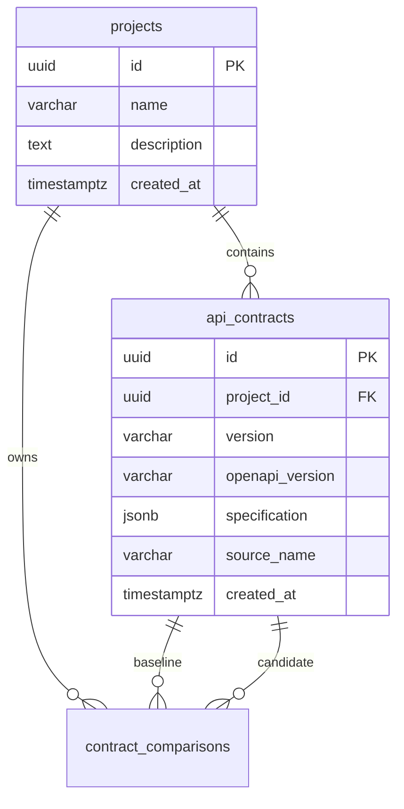

# API Contract Copilot

Analyze how OpenAPI contract changes affect consumer integrations, then produce evidence-backed impact reports and migration plans.

**Status:** project workspace plus validated contract-upload APIs. Create/list/select projects in React; upload immutable OpenAPI JSON/YAML versions through the API and read project-scoped contract metadata/specifications. See the [contract upload walkthrough](docs/contract-uploads.md). The React Contracts screen uploads files, lists saved metadata and selects distinct baseline/candidate versions; a [pinned comparison runner](docs/contract-comparison.md) is available as a backend demo. Saved project-scoped comparisons and selected-change lookup are available through the API. The live Comparison screen runs saved comparisons, filters severity, reopens history, and retrieves selected-change evidence. A [bounded exact code-search backend demo](docs/code-search.md) is also available. A typed internal `search_code` tool registry preserves evidence and explicit failure states. Project-scoped [text/Markdown ingestion](docs/document-ingestion.md) persists immutable documents and stable citation chunks. [Filtered PostgreSQL document retrieval](docs/document-retrieval.md) is available through the API and `search_knowledge` tool. A [typed model-provider boundary](docs/model-providers.md) includes an offline fake and opt-in OpenAI adapter. Code-search API integration, impact analysis, agents, approvals, and MCP remain tracked implementation work. See the [step-by-step demo and review checkpoints](docs/mvp-steps.md).

[Project and task tracker](https://github.com/users/r-kovalenko/projects/2) · [CI runs](https://github.com/r-kovalenko/api-contract-copilot/actions)

## Repositories

| Repository | Responsibility |
| --- | --- |
| [api-contract-copilot](https://github.com/r-kovalenko/api-contract-copilot) | React UI, FastAPI modular monolith, application data, orchestration, RAG, approvals, and Copilot MCP |
| [api-provider-demo](https://github.com/r-kovalenko/api-provider-demo) | Synthetic versioned customer API, OpenAPI contracts, changelog, migration docs, and planned provider MCP |
| [api-consumer-demo](https://github.com/r-kovalenko/api-consumer-demo) | Example v1 integration, compatibility tests, and planned consumer MCP |

Keep the frontend and backend together so cross-layer changes can be tested and reviewed in one pull request. The two demo repositories provide independent codebases for MCP integration.

## Run locally from a fresh clone (Windows)

Install Git and Docker Desktop first. Start Docker Desktop with Linux containers and wait until its engine is running. This Docker setup does not require a separate Python or Node.js installation. Use PowerShell for the commands below.

### 1. Create a directory and clone the project

```powershell
New-Item -ItemType Directory -Force C:\Projects
cd C:\Projects
git clone https://github.com/r-kovalenko/api-contract-copilot.git
cd api-contract-copilot
```

Git creates `C:\Projects\api-contract-copilot` automatically. If you already cloned the repository, use its existing directory instead. Run all following Docker commands from the repository root, where `compose.yaml` is located.

### 2. Configure the local database

```powershell
if (!(Test-Path .env)) { Copy-Item .env.example .env }
notepad .env
```

Set `POSTGRES_PASSWORD` to your own unique local password, then save and close Notepad:

```dotenv
POSTGRES_USER=copilot
POSTGRES_PASSWORD=replace-with-your-local-password
POSTGRES_DB=copilot
DATABASE_URL=
```

Leave `DATABASE_URL` and the API keys empty. The current upload/comparison flow does not need an LLM key or the demo repositories running. `.env` is ignored by Git; never commit its populated contents. If a database volume already exists, retain its original password: changing `.env` does not change the stored database credentials.

### 3. Build, start, and create the database tables

```powershell
docker compose up -d --build
```

The first build downloads images and dependencies and can take several minutes. After it finishes successfully, apply the migrations:

```powershell
docker compose exec backend python -m alembic upgrade head
docker compose ps
```

Migrations are explicit; application startup does not run them automatically. Docker installs the pinned comparison engine as part of the backend build.

### 4. Open the application and try the demo

- Application: [http://localhost:8080](http://localhost:8080)
- Interactive API docs: [http://localhost:8000/docs](http://localhost:8000/docs)
- Database readiness: [http://localhost:8000/api/ready](http://localhost:8000/api/ready) — should return HTTP 200 after migrations.

1. Create a project and select **Manage contracts**.
2. Upload `C:\Projects\api-contract-copilot\docs\examples\customer-v1.json` with version label `v1`.
3. Upload `C:\Projects\api-contract-copilot\docs\examples\customer-v2.yaml` with version label `v2`.
4. Choose baseline `v1` and candidate `v2`, then click **Compare contracts**.
5. Filter changes by severity and select a change to inspect its saved evidence. Reload, reselect the project, and open **Comparison** to reopen the saved result.

Impact analysis is not implemented yet. This is an unauthenticated, local single-user preview; use synthetic data.

### 5. Stop, restart, or update

Stop the application while keeping saved projects, contracts, and comparisons:

```powershell
docker compose down
```

Start it again with `docker compose up -d`. To update an existing checkout with no uncommitted changes:

```powershell
cd C:\Projects\api-contract-copilot
git switch main
git pull --ff-only
docker compose up -d --build
docker compose exec backend python -m alembic upgrade head
```

Do not add `--volumes` or `-v` to the stop command unless you intend to delete the local database.

### Troubleshooting

```powershell
docker compose ps
docker compose logs --tail=100 backend frontend db
```

- **Git or Docker command not found:** install the missing prerequisite and reopen PowerShell.
- **Cannot connect to the Docker engine:** start Docker Desktop and wait until it is ready.
- **Port already allocated:** stop the local service using port 8080, 8000, or 5432, then retry startup.
- **Readiness returns 503:** confirm the database is running and run `docker compose exec backend python -m alembic upgrade head`; inspect the logs if it still fails.
- **Password authentication failed after editing `.env`:** restore the password used when the database volume was initialized. Stopping and starting containers preserves that volume.

## Local development

For running the processes outside containers, use Python 3.12 and Node.js 24. For the complete Docker setup, follow the fresh-clone guide above.

```sh
cd backend
python -m venv .venv
# Windows: .venv\Scripts\Activate.ps1
# macOS/Linux: source .venv/bin/activate
python -m pip install -r requirements-dev.txt
python -m uvicorn app.main:app --reload
```

In another terminal:

```sh
cd frontend
npm ci
npm run dev
```

Backend liveness: http://localhost:8000/api/health. Database readiness: http://localhost:8000/api/ready. API docs: http://localhost:8000/docs. Vite prints the frontend development URL and proxies `/api` to the backend. The UI creates and lists projects through the API. This unauthenticated, single-user preview must remain local; use synthetic data.

For the container stack, copy `.env.example` to `.env`, set a unique local `POSTGRES_PASSWORD`, then:

```sh
docker compose up -d --build
# Explicit schema changes; application startup never runs migrations automatically:
docker compose exec backend python -m alembic upgrade head
docker compose exec backend python -m alembic current
```

Container UI: http://localhost:8080. Compose starts PostgreSQL with pgvector and passes database settings only to the backend. Readiness returns HTTP 503 until migrations are applied, and HTTP 200 afterward. Local database credentials are development-only. Changing `.env` credentials does not change credentials in an already initialized database volume.

## Database models

The implemented foundation is in [backend/app/db/models.py](backend/app/db/models.py), with its initial migration in [backend/alembic/versions/0001_projects_contracts.py](backend/alembic/versions/0001_projects_contracts.py).

| Model / table | Columns | Relationships and constraints |
| --- | --- | --- |
| `Project` / `projects` | UUID `id`, `name` (200 characters), nullable `description`, timezone-aware `created_at` | Nonblank name; one project has many contract versions |
| `ContractComparison` / `contract_comparisons` | UUID `id`, `project_id`, `baseline_id`, `candidate_id`; engine and normalization versions; change count; JSONB result; timestamp | Composite foreign keys enforce same-project versions; distinct ordered pair; unique pair per engine/normalization version; complete deterministic evidence |
| `ApiContract` / `api_contracts` | UUID `id`, UUID `project_id`, `version` (100 characters), `openapi_version` (20 characters), JSONB `specification`, nullable `source_name` (255 characters), timezone-aware `created_at` | Required project FK; unique `(project_id, version)`; nonblank version; OpenAPI version starts with `3.`; specification must be a JSON object |



UUIDs are generated by the Python model; creation timestamps are generated by PostgreSQL. The composite uniqueness constraint also indexes project/version lookup. Database foreign keys block deleting a project that still owns contracts. The repository lookup requires both project ID and contract ID. `session_scope(engine)` commits successful work and rolls back failures. These persistence controls do not implement authentication or full OpenAPI validation; those belong to the upload/API feature.

The comparison migration `0002_contract_comparisons` adds saved results; downgrading it to `0001_projects_contracts` removes comparisons while preserving uploaded contracts and projects.

The initial migration enables the database-wide `vector` extension. The migration role needs permission to create it, or an administrator must provision it first. Embeddings are not stored yet. Downgrading to `base` deletes all application tables and their data, but deliberately retains the potentially shared extension. Back up data before downgrading.

For a backend running outside Compose, export a server-only `DATABASE_URL` using the `postgresql+psycopg://` scheme, then run `python -m alembic upgrade head` from `backend/`. Percent-encode special characters in URL credentials. Compose safely constructs the URL from its separate `POSTGRES_*` values unless `DATABASE_URL` overrides them. Python does not automatically load `.env`. Never put the database URL in frontend variables or commit its populated value.

`/api/ready` requires connectivity, the current Alembic head, and the vector extension. Driver errors return a generic HTTP 503 without credential or connection details. Connections and queries have bounded timeouts; `/api/health` remains a process-only check.

Planned models from the [system design](docs/system-design.md) are intentionally deferred to their feature migrations: documents/chunks (RAG), analysis runs (analysis; normalized changes are already stored in comparison results), sessions/messages/workflow states/tool calls (orchestration), and migration plans/approval requests/migration tasks (planning and approval).

## Tests and CI

```sh
cd backend
python -m ruff check .
python -m ruff format --check .
# Install ripgrep as described in docs/code-search.md and verify rg --version.
python install_oasdiff.py
python -m pytest --cov=app
cd ../frontend
npm ci
npm run typecheck
npm test
npm run build
```

Database tests use a **disposable, initially empty PostgreSQL database whose name ends in `_test`**, with pgvector available. Export its URL as `TEST_DATABASE_URL` and run `python -m pytest -m integration` from `backend/`. Tests apply and roll back migrations and delete test tables; never point them at application data. Without that setting, local database tests are skipped. Required CI provisions its own PostgreSQL/pgvector service and sets `REQUIRE_DATABASE_TESTS=1`, so database tests cannot silently skip. The suite checks schema/model agreement, upgrade/downgrade/re-upgrade, version uniqueness, foreign keys, transaction rollback, project isolation, and readiness transitions.

Pull requests run Python lint/format checks, pytest, frontend type checks/tests/build, and container build/smoke tests. The `CI` check summarizes all jobs. Test reports are uploaded as artifacts. Main-branch pushes also publish tested container images to GHCR tagged by the full Git commit SHA. No paid model calls or deployment credentials are required for CI.

See [delivery details](docs/ci-cd.md), [contribution guidance](CONTRIBUTING.md), and the [implementation backlog](docs/backlog.json). Dependency versions are locked in `requirements-dev.txt`, `requirements-runtime.txt`, and `package-lock.json`. GitHub Actions are pinned to reviewed release commits; Dependabot proposes weekly updates.

## Requirements and architecture

The [React design system](docs/design-system.md) includes shared components, color tokens, and responsive screens. Projects and Contracts use the real API; Comparison, Impact Report, and Components are explicitly labelled sample previews for design review.

[Product requirements](docs/prd.md) and [system design](docs/system-design.md) describe the target MVP. Deterministic tools supply contract facts and exact code evidence; RAG supplies contextual sources; LLMs interpret those inputs. The orchestrator owns persisted state and approval decisions.

Public repository visibility is not an open-source license. License selection is tracked as an owner decision.

## Coding and security

Project skills are in `.agents/skills/`; repository guidance is in [AGENTS.md](AGENTS.md). Follow the [OWASP control baseline](docs/security.md) and [GitHub environment-secret guide](docs/secrets.md). Required CI includes Gitleaks, Bandit, dependency audits, and CodeQL analysis before image publication.

### Documentation storage

`documents` stores project/provider/API-version/type/source provenance, content hash and chunking version. `document_chunks` stores immutable citation IDs, ordered text and character offsets, linked to its document. Migration `0003_documents` creates both tables; see the [ingestion walkthrough](docs/document-ingestion.md).
