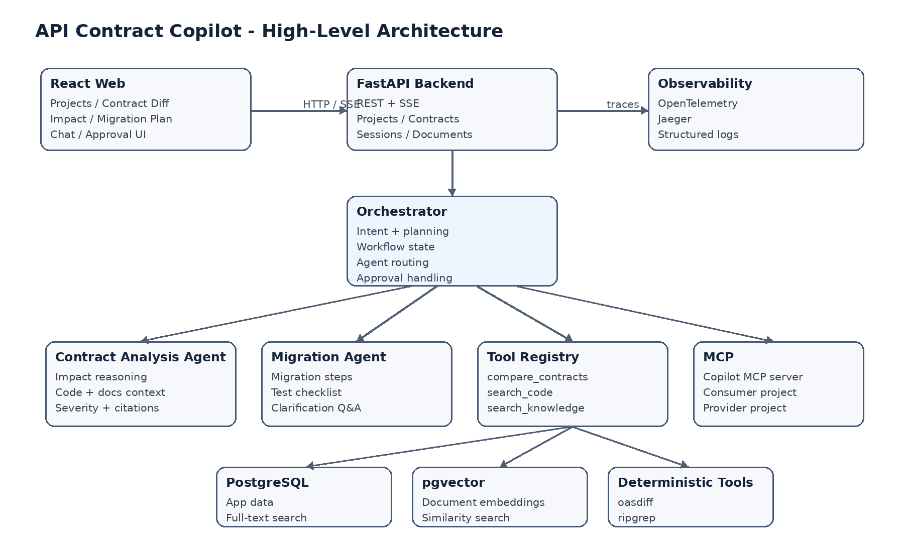

# API Contract Copilot System Design

Markdown transcription of [System_Design.docx](System_Design.docx). Requirements describe the target MVP, not current implementation status. Subsequent repository security conventions are documented separately in [security.md](security.md).

API Contract Copilot

System Design

Learning project architecture for API contract change impact analysis

> Design intent<br>Production-style enough to demonstrate RAG, agents, tools, MCP, approvals, planning, tracing, sessions, and dynamic UI - while remaining small enough to build as a learning project.

Version 1.0  |  October 2026

## 1. Design Goals and Scope

API Contract Copilot helps an engineer understand how an API contract change affects an existing consumer integration. The system combines deterministic contract comparison, code search, retrieval-augmented generation (RAG), and LLM-based reasoning to produce an evidence-backed impact report and migration plan.

- Prefer deterministic tools for facts that can be computed reliably.

- Use RAG for contextual knowledge such as changelogs, migration guides, and internal notes.

- Use LLMs for interpretation, explanation, prioritization, and planning - not as the source of truth for contract diffs.

- Keep one central orchestrator and a small number of specialist agents.

- Persist workflow state so planning, clarification, and approval flows can resume safely.

- Start as a modular monolith; avoid microservices and heavy agent frameworks in the MVP.

> Core architecture principle<br>LLM != source of truth. Contract changes come from deterministic comparison, exact code matches come from search tools, knowledge comes from RAG, and the LLM explains the combined evidence.

## 2. Primary Use Cases

| Use case | Outcome |
| --- | --- |
| Compare API versions | Detect breaking and non-breaking OpenAPI changes. |
| Analyze one change | Find relevant code and documentation, then explain likely impact. |
| Plan migration | Generate implementation steps, tests, and open questions. |
| Ask follow-up questions | Continue analysis using persisted session and workflow context. |
| Approve action | Require explicit approval before creating a migration task. |
| Expose via MCP | Allow external AI clients/projects to query contract and change information. |

## 3. High-Level Architecture



## 4. Component Responsibilities

| Component | Responsibility |
| --- | --- |
| React Web | Project setup, contract diff view, chat, impact report, migration plan, approval UI, dynamic event rendering. |
| FastAPI Backend | HTTP/SSE API, validation, business services, persistence, workflow entry points. |
| Orchestrator | Intent, planning, workflow state, agent/tool routing, clarification, approval, resume. |
| Contract Analysis Agent | Combines contract change + code matches + RAG context to create an impact report. |
| Migration Agent | Creates migration steps, test checklist, open questions, and proposed task. |
| Tool Registry | Typed access to deterministic tools and RAG/MCP capabilities. |
| RAG Layer | Document ingestion, chunking, embeddings, hybrid retrieval, citations. |
| MCP Layer | Copilot MCP server plus clients to two demo projects. |
| Persistence | Projects, contracts, changes, sessions, messages, workflow state, tool runs, approvals. |
| Observability | End-to-end traces, structured logs, latency, token and retrieval metrics. |

## 5. Technology Stack

| Layer | Choice | Why |
| --- | --- | --- |
| Frontend | React + TypeScript | Familiar UI stack; typed dynamic UI events. |
| Backend | Python + FastAPI | Learn Python AI ecosystem with a simple async API framework. |
| Validation | Pydantic v2 | Strong schemas for API payloads, tool inputs, and structured LLM outputs. |
| Persistence | PostgreSQL + SQLAlchemy 2 + Alembic | Single relational store for app state and migrations. |
| Vector search | pgvector | Keeps RAG storage in the same database for MVP simplicity. |
| Keyword search | PostgreSQL FTS | Supports hybrid retrieval without another search service. |
| LLM | OpenAI / Claude via provider interface | Model flexibility and easy test doubles. |
| Contract diff | oasdiff | Deterministic OpenAPI comparison. |
| Code search | ripgrep / MCP | Simple exact search first; advanced AST analysis is deferred. |
| MCP | Python MCP SDK | Expose and consume tools/resources across demo projects. |
| Tracing | OpenTelemetry + Jaeger | Vendor-neutral traces with a local visualizer. |
| Testing | pytest + pytest-asyncio | Native async Python testing. |

## 6. Backend Structure

```text
backend/
  app/
    api/              # FastAPI routes
    core/             # config, logging, exceptions
    db/               # session, models, repositories
    schemas/          # Pydantic request/response models
    ai/
      orchestrator.py
      workflow_state.py
      providers/      # OpenAI / Anthropic adapters
      agents/         # contract + migration agents
      tools/          # registry + deterministic tools
      rag/            # ingestion + retrieval
    mcp/              # MCP server + clients
    services/         # application/business services
    observability/    # tracing + metrics
  alembic/
  tests/
  pyproject.toml
```

## 7. Main Analysis Workflow

1. User selects OpenAPI v1 and v2 and starts an analysis.

1. FastAPI validates the request and creates an analysis run.

1. Orchestrator creates/persists WorkflowState and starts a trace.

1. compare_contracts runs deterministically and produces structured changes.

1. For a selected change, search_knowledge retrieves relevant docs and search_code finds exact usages.

1. Contract Analysis Agent combines the evidence into a structured impact report with citations.

1. Migration Agent creates steps, test checklist, and open questions.

1. Backend emits typed UI events; the frontend renders trusted components.

1. If the user requests a write action, the workflow pauses for approval and resumes only after a decision.

```text
OpenAPI v1 + v2
       |
       v
compare_contracts (deterministic)
       |
       v
structured breaking changes
       |
       +--> search_knowledge (RAG)
       +--> search_code (exact/MCP)
       |
       v
Contract Analysis Agent
       |
       v
Impact Report + Citations
       |
       v
Migration Agent -> Plan / Questions / Approval
```

## 8. Workflow State and Resumability

The workflow is stateful because planning, clarification, and approval may span multiple user turns. State is stored after important transitions so a request can be resumed without replaying the entire process.

| State | Meaning |
| --- | --- |
| running | Workflow is executing tools/agents. |
| waiting_for_user | A clarification question must be answered. |
| waiting_for_approval | A proposed write action is paused. |
| completed | Final result is available. |
| failed | Execution stopped with a recorded error. |

```text
WorkflowState
- id, project_id, session_id, trace_id
- intent, status, plan
- contract_changes
- retrieved_documents
- affected_files
- tool_results
- impact_report
- migration_plan
- approval_request_id
```

## 9. Tools and Deterministic Boundaries

| Tool | Input | Output | Why deterministic / controlled |
| --- | --- | --- | --- |
| compare_contracts | Old + new OpenAPI specs | Structured ContractChange[] | LLM should not decide syntactic compatibility. |
| search_code | Validated search terms + repo | File/line matches | Exact evidence is more reliable than generated guesses. |
| search_knowledge | Question/change + filters | Ranked chunks + source IDs | Retrieval is controlled; LLM only interprets results. |
| run_contract_tests (optional) | Selected test target | Pass/fail + logs | Executable validation if added later. |

## 10. RAG Design

### 10.1 Sources

- Vendor API documentation

- Changelogs

- Migration guides

- Internal integration notes

- Architecture notes

### 10.2 Ingestion

```text
Document -> Parse -> Chunk -> Metadata -> Embedding -> PostgreSQL / pgvector
```

Each chunk stores project, document type, provider, API version, and source reference metadata. This enables project/version filtering before ranking.

### 10.3 Retrieval

```text
Query / contract change
        |
        +--> PostgreSQL full-text search
        +--> pgvector similarity search
        |
        v
merge (RRF or simple weighted ranking)
        |
        v
Top 5-10 chunks -> LLM context + citations
```

> MVP choice<br>Use hybrid retrieval but skip a dedicated reranking model initially. Add reranking only if evaluation shows retrieval quality is insufficient.

## 11. Agents and Planning

### 11.1 Contract Analysis Agent

- Input: structured contract change, code matches, RAG results.

- Output: severity, summary, affected files, recommendations, source IDs.

- No direct calls to other agents; all tool use is coordinated through the orchestrator/tool registry.

### 11.2 Migration Agent

- Input: contract change, impact report, relevant documentation.

- Output: ordered migration steps, test checklist, open questions, proposed migration task.

### 11.3 Planning Mode

Planning is used only for broad requests. A short structured plan is stored in workflow state. Missing information moves the workflow to waiting_for_user instead of letting the model guess.

## 12. MCP Design

| Surface | Operations |
| --- | --- |
| Copilot MCP Server | get_contract; list_contract_versions; compare_contracts; search_api_docs; get_change_details |
| Consumer Demo MCP | search_code; get_file; list_dependencies |
| Provider Demo MCP | get_openapi_spec; get_api_version; get_changelog |

The two demo MCP projects are intentionally small. Their purpose is to demonstrate MCP integration, not to build full GitHub/Jira/observability connectors.

## 13. Data Model

| Entity | Purpose |
| --- | --- |
| projects | Top-level workspace for one integration analysis. |
| api_contracts | Stored contract versions and metadata. |
| contract_changes | Normalized diff results between versions. |
| documents | Knowledge source metadata. |
| document_chunks | Chunk text, embedding, and retrieval metadata. |
| sessions / messages | Conversation history. |
| analysis_runs | One end-to-end analysis execution. |
| workflow_states | Persisted resumable orchestrator state. |
| tool_calls | Inputs, outputs, duration, status, trace data. |
| migration_plans | Generated plan and test checklist. |
| approval_requests | Pending/approved/rejected actions. |
| migration_tasks | MVP write-action result. |

## 14. API Surface (MVP)

| Method | Endpoint | Purpose |
| --- | --- | --- |
| POST | /projects | Create a project. |
| POST | /projects/{id}/contracts | Upload a contract version. |
| POST | /projects/{id}/documents | Upload/index documentation. |
| POST | /analyses | Start contract comparison/impact analysis. |
| GET | /analyses/{id} | Read current analysis state. |
| GET | /analyses/{id}/events | SSE stream of typed UI events. |
| POST | /sessions/{id}/messages | Ask follow-up / answer clarification. |
| POST | /approvals/{id}/decision | Approve or reject a write action. |

## 15. Dynamic UI

The LLM never generates raw HTML or JavaScript. The backend emits typed events and the frontend maps each event to a trusted React component.

```text
message
plan
plan_step
contract_change
affected_files
source_list
impact_summary
migration_plan
tool_execution
approval_request
error
```

## 16. Observability

```text
analysis.run
  |- orchestrator.intent
  |- tool.compare_contracts
  |- agent.contract_analysis
  |    |- rag.search
  |    `- tool.search_code
  |- agent.migration
  `- approval.create
```

- Trace ID, project ID, session ID

- Model name and token usage

- LLM/tool/MCP/RAG latency

- Retrieved chunk IDs and scores

- Agent/tool errors and retries

- Approval wait/resume events

## 17. Security and Safety Boundaries

- Secrets are stored outside prompts and source code (environment/secret store).

- No arbitrary shell command is exposed to the model.

- oasdiff/ripgrep subprocesses use validated arguments, never raw model-generated command strings.

- MCP exposes only explicitly defined methods.

- Write actions pass through a policy check and require approval.

- Uploaded/project data is scoped by project; multi-tenant enterprise authorization is out of MVP scope.

## 18. Failure Handling

| Failure | Behavior |
| --- | --- |
| LLM timeout / invalid structured output | Limited retry; Pydantic validation; fail with explicit error if still invalid. |
| Tool failure | Persist failure; return evidence gap; never fabricate a result. |
| MCP unavailable | Continue with partial analysis and mark source unavailable. |
| Weak RAG retrieval | State limited evidence; avoid unsupported citations. |
| Approval not answered | Keep workflow paused and resumable. |

## 19. Deployment Model

```text
React frontend
      |
      v
FastAPI modular monolith
      |
      +--> PostgreSQL + pgvector
      +--> S3-compatible storage (optional)
      +--> OpenTelemetry -> Jaeger
      +--> External LLM API
      +--> Demo MCP projects
```

Local development uses Docker Compose. Redis/Celery is intentionally omitted until document ingestion or long-running jobs prove that a queue is needed.

## 20. Non-Functional Requirements

| Area | MVP target |
| --- | --- |
| Latency | Typical single-change demo analysis < 10 seconds, excluding unusually slow external model calls. |
| Reliability | Failed tool/LLM calls are handled without corrupting persisted workflow state. |
| Traceability | 100% of agent/tool executions have a trace ID. |
| Approval safety | 100% of write actions require explicit approval. |
| Retrieval quality | Relevant source appears in top-5 for >=80% of a curated evaluation set. |
| Maintainability | Typed boundaries: Pydantic schemas for API, tools, agents, workflow state, and UI events. |

## 21. Key Design Decisions and Trade-offs

| Decision | Reason | Trade-off |
| --- | --- | --- |
| Modular monolith | Simpler learning/deployment and transactions. | Less independent scaling; acceptable for MVP. |
| Custom orchestrator first | Makes agent/tool/state mechanics visible. | More code than a framework; intentional for learning. |
| PostgreSQL + pgvector | One persistence platform. | Less specialized than dedicated vector/search systems. |
| ripgrep first | Fast to implement and easy to verify. | No semantic/AST-level dependency analysis. |
| Deterministic diff tool | Reliable compatibility facts. | Depends on external CLI behavior/version. |
| SSE for UI events | Simple server-to-client streaming. | Not bidirectional like WebSocket; sufficient for this UX. |

## 22. Implementation Plan

| Phase | Deliverable |
| --- | --- |
| 1. Foundation | FastAPI app, database, project/contract upload, basic React shell. |
| 2. Vertical slice | oasdiff comparison -> select change -> docs retrieval -> code search -> impact report. |
| 3. RAG quality | Hybrid retrieval, metadata filters, citations, evaluation set. |
| 4. Agent workflow | Contract agent, migration agent, planning/Q&A, persisted workflow state. |
| 5. HITL + Dynamic UI | Approval flow, SSE events, React cards. |
| 6. MCP | Copilot MCP server + consumer/provider demo MCP projects. |
| 7. Observability | OpenTelemetry traces, metrics, Jaeger, error paths. |
| 8. Evaluation / polish | Automated tests, RAG evaluation, demo dataset, deployment. |

> First usable vertical slice<br>Upload OpenAPI v1/v2 -> compare -> select breaking change -> retrieve docs -> search affected code -> generate impact report. Build this before adding planning, approval, MCP, or advanced agent behavior.

## 23. Explicitly Out of MVP

- LangChain / LangGraph at the start

- Celery, Kafka, Kubernetes

- Dedicated vector database or Elasticsearch

- Microservices

- Large-repository AST dependency graphs

- Runtime production traffic analysis

- Automatic code changes or PR creation

- Autonomous production remediation

- Enterprise SSO, billing, multi-tenant organization support

## 24. Definition of Done

- Two OpenAPI versions can be uploaded and compared.

- Breaking changes are displayed as structured data.

- A selected change can be analyzed against documentation and a codebase.

- Impact report includes evidence/citations and affected files.

- Migration plan and clarification questions work.

- Write action is paused for approval and resumes correctly.

- Sessions/workflow state persist across requests.

- At least five Copilot MCP operations are available and two demo projects are connected.

- LLM, RAG, tool, agent, and MCP calls are visible in traces.

- Core flows have automated tests and the demo runs locally via documented setup.
